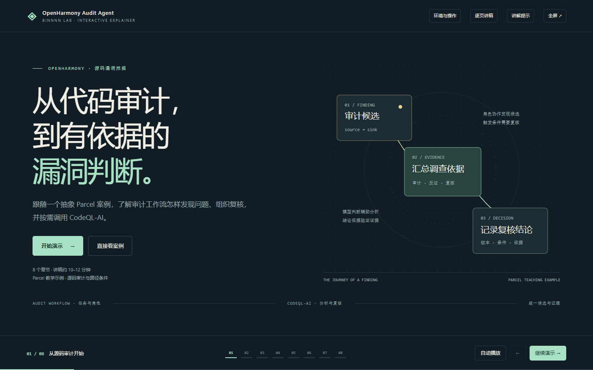
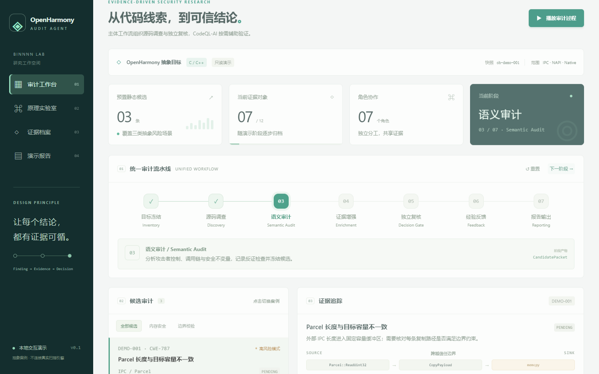

# OpenHarmony-Audit-Agent

OpenHarmony-Audit-Agent 以 **audit-workflow-prompts 审计工作流为主体**，组织源码调查、角色协作、不变量与变体发现、反证、候选冻结、盲验证和 checkpoint。**CodeQL-AI 是按需辅助验证能力**，为具体路径、保护函数和误报假设补充依据。

## 主体与辅助如何衔接

主体从代码快照、威胁模型与安全不变量开展审计，不要求已有 CodeQL 告警。总控分配角色、形成候选并组织复核；遇到具体技术问题时，调用可用的 CodeQL-AI 工具，将结果关联到原候选版本。工具不可用时记录验证缺口，继续可完成的源码审计。

主线是 `Target → Audit roles → CandidatePacket → Independent review → Report`。可选辅助路径是 `Candidate question → CodeQL-AI → Evidence → 主体复核`。详细实现和未接通部分见 [整合状态](docs/integration-status.md)。

## 题目一交付材料

见 [官方要求与交付清单](docs/competition-checklist.md)。技术说明书、使用说明书、原型视频、性能说明和源码包整理在 `deliverables/`。具体漏洞材料由团队后续提供。性能资料中的规划模块数据不能替代大规模源码审计实测；清单明确列出这一缺口。

## 快速开始

### HTML 原理与流程演示（推荐）

[录屏材料包](deliverables/03-recording-kit.zip) 包含可直接转发的单文件演示 HTML 和逐页口语讲稿。打开 [录屏网页](deliverables/03-recording-demo.html)，照着 [讲稿](deliverables/03-narration.html) 操作并自行录制即可。演示文件内嵌环境说明与完整讲稿，复制到其他电脑后可直接用浏览器离线打开。

[逐页录屏讲解稿](frontend/narration.html) 对应八章 DEMO，正文直接朗读，操作提示单独标注，全程约 10–12 分钟；[Markdown 原稿](frontend/NARRATION.md) 便于修改或打印。[工具使用说明书](frontend/manual.html) 另有详细依赖、安装和故障处理说明。

直接用浏览器打开 [frontend/demo.html](frontend/demo.html)，无需安装依赖或联网。八个章节串起两个工具的分工、Parcel 案例、路径约束实验、独立验证、经验反馈和实验设计，支持键盘推进、全屏、自动播放与讲解提示。讲解顺序见 [演示说明](frontend/DEMO.md)。

也可通过下方本地服务访问 http://127.0.0.1:8765/demo.html。



### 原有交互工作台（保留）

```shell
python scripts/serve_demo.py
```

打开 http://127.0.0.1:8765，体验可播放的审计流程、调用链与证据追踪、结论判定实验和报告导出。前端使用纯静态文件，不需要 Node 构建或 API key。所有案例都标注为抽象演示，未连接实际审计引擎。详细讲解顺序见 [前端说明](frontend/README.md)。



### Python 工具

```powershell
python -m pip install -e .
python -m openharmony_audit workflow validate --workflow config/workflow.audit.example.json --target config/target.openharmony.abstract.json
python -m openharmony_audit workflow plan --workflow config/workflow.audit.example.json --target config/target.openharmony.abstract.json
python -m openharmony_audit workflow prepare --workflow config/workflow.audit.example.json --target config/target.openharmony.abstract.json --run-root reports/run-data --allow-missing-source
python -m openharmony_audit workflow status --run-root reports/run-data
```

上述操作不调用模型或 CodeQL。准备真实任务时替换源码路径、快照和模型配置，去掉 `--allow-missing-source`；配置 Claude Code 认证后，可执行 `python -m openharmony_audit workflow run --run-root reports/run-data`。该命令会启动实际 Agent，当前交付未执行真实源码审计。OpenAI-compatible 独立适配器尚未接入主体并行 runner。

兼容的辅助与报告命令：

```powershell
python -m openharmony_audit validate-target --target config/target.openharmony.abstract.json
python -m openharmony_audit prepare --target config/target.openharmony.abstract.json --run-root reports/run-data/compatibility
python -m openharmony_audit report --output reports/technical-report.md --pdf reports/technical-report.pdf
```

CodeQL、angr、FastMCP 和 PDF 依赖均为可选能力，分别见 `pyproject.toml` 的 optional dependencies。当前抽象 profile 不绑定真实 OpenHarmony 源码、设备或漏洞结果。

## 目录

- `src/openharmony_audit/contracts`：统一 Campaign、Finding、Candidate、Evidence、Decision 和 Experience 契约。
- `src/openharmony_audit/workflow`：分片规划、阶段调度和 checkpoint。
- `src/openharmony_audit/engines/codeql`：CodeQL 命令和 SARIF 入口。
- `src/openharmony_audit/engines/codeql_ai`：内嵌的 CodeQL-AI provider 和可选 MCP 服务。
- `src/openharmony_audit/runtimes`：Claude Code 与 OpenAI-compatible 双 runtime。
- `src/openharmony_audit/evidence`：SARIF 归一化、provenance、经验库和证据审核。
- `docs/technical-report.md`：中文技术方案主报告。
- `reports/technical-report.pdf`：由报告主稿生成的 PDF。

## 边界

主体的任务包、角色与运行入口已接入；辅助 provider 的自动调用、证据规范化和归档闭环仍需目标环境联调。没有有效确定性验证的候选保留 `STATIC_ONLY`；完整基础证据缺失则为 `NEEDS_EVIDENCE`。PoC 计划不等同于实际执行。本项目不自动披露漏洞。来源及重构范围见 [NOTICE.md](NOTICE.md)。

