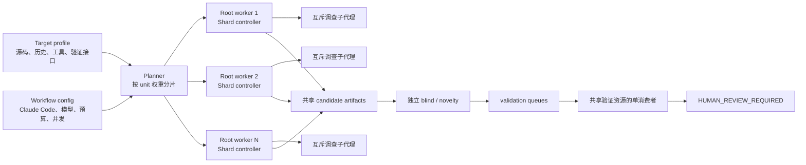

# 通用 0day Agent 代码分析工作流

本文说明从 OpenHarmony `patch-gap` 0day 审计系统中提取出的通用工作流。目标是保留已经验证过的 Agent 分工、证据隔离、并行分片、候选状态机、动态验证队列和检查点恢复，同时把 OpenHarmony 的 release manifest、14 个组件、GitCode 历史、GN/HAP、RK3568、SRC 中文报告以及具体模型全部移到可替换接口。

提取后的实现位于 `audit_workflow/`。它可以直接为普通 Git 仓库、没有 Git 元数据的源码目录或反编译导出树生成分片计划、独立 worker 工作区和 Claude Code prompt，并用配置指定的模型并行运行 root workers。原 `patch-gap/` 保留为 OpenHarmony 的完整生产适配实现；两者的关系是“通用编排核心 + 目标适配 profile”，而不是复制两套分析方法。

## 1. 原工作流是什么

原实现的权威入口是 `solutions/claude-code/zeroday/patch-gap/`。其完整流程不是简单地让模型遍历源文件，而是从可信线索提炼安全不变量，再用多角色 Agent 寻找同源变体：

```text
冻结目标基线
  -> 合并 legacy 漏洞与历史修复 seed
  -> Seed curator 逐条确认 seed
  -> Repair analyst 提炼安全不变量
  -> Variant hunter 搜索残留入口、未修 sibling、组合链
  -> Chain composer 重建 entry-to-impact 路径
  -> 冻结候选
  -> Blind verifier 独立复核
  -> Master novelty verifier 查重
  -> PoC planner 生成验证计划
  -> Capability assessment
  -> READY / EVIDENCE_INSUFFICIENT / TOOLING_INSUFFICIENT
  -> 独立 validation worker 动态验证
  -> 人工复核包
```

原系统有三种实际运行拓扑：

| 模式 | 模型 | 并行方式 | 终点 |
| --- | --- | --- | --- |
| 通用 `launch-claude-code.sh` | `deepseek-v4-flash` | 一个 controller 内最多 4 个仓库调查分支 | 正式候选流水线 |
| `static-100` | `deepseek-v4-flash` | 4 个独立 Podman worker，共享只写 output | `UNVERIFIED_STATIC_CANDIDATE` |
| 当前 SP1 live | `gpt-5.6-luna`，effort `max` | 审计前端与唯一 validation worker 双流水线 | 实机确认与人工复核 |

因此“Claude Code + DeepSeek”是通用/静态运行 profile。Claude Code 是 Agent runtime，DeepSeek 是通过 Anthropic-compatible API 使用的模型。当前 SP1 live 已换模型，说明模型必须属于运行时配置，不能写进分析流程本身。

## 2. 提取后的设计

通用系统分为四层：

1. `TargetProfile` 描述目标、analysis units、威胁模型和目标适配接口。
2. `WorkflowConfig` 描述模型运行时、阶段预算、root worker 数量、worker 内子代理角色和验证串行策略。
3. planner 把 analysis units 做确定性分片，为每个 root worker 生成独立 assignment 与 prompt。
4. runner 并行启动 Claude Code；每个 worker 自行编排调查子代理、冻结候选、盲验并维护检查点。



核心的并行原则是：analysis unit/仓库之间并行；一个候选的阶段按顺序执行；共享设备、全局构建目录和有外部副作用的验证串行；审计前端与验证后端可以并行。这与当前 OpenHarmony live 拓扑一致。

## 3. 通用状态与阶段包

一个候选的逻辑状态如下：

```text
INVENTORY
  -> SEED_CURATED
  -> OBLIGATION_EXTRACTED
  -> VARIANT_DISCOVERED
  -> AUDIT_COMPLETE
  -> BLIND_COMPLETE
  -> NOVELTY_COMPLETE
  -> POC_COMPLETE
  -> CAPABILITY_COMPLETE
  -> READY | EVIDENCE_INSUFFICIENT | TOOLING_INSUFFICIENT
  -> VALIDATED | REJECTED | STATIC_ONLY
  -> HUMAN_REVIEW_REQUIRED
```

`OBLIGATION_EXTRACTED` 在通用设计中表示“安全不变量已经明确”。它不要求目标一定有 fixing commit：

- Git repair seed 可以从 parent/child diff 提炼不变量；
- 静态工具 seed 可以从 source/sink、规则和调用约定提炼；
- 反编译目标可以从协议规范、人工 invariant、版本二进制 diff 或危险 API 模式提炼；
- 没有历史时，introducing commit 和 repair edge 留空，不能伪造。

`AUDIT_COMPLETE → BLIND_COMPLETE → NOVELTY_COMPLETE → POC_COMPLETE → CAPABILITY_COMPLETE` 使用不可变阶段包。每个包记录输入 artifact ID、producer role、输出 payload 和候选 revision。冻结内容发生实质变化时创建下一 revision，不覆盖 blind verifier 已经看过的内容。

## 4. 配置文件

运行时和目标适配分成两个 JSON 文件。

### 4.1 WorkflowConfig

示例：`config/workflow.deepseek.example.json`。

| 字段 | 含义 |
| --- | --- |
| `campaignId` | 本次运行的稳定 ID |
| `promptDir` | 通用角色 prompt 目录；`builtin:generic` 使用随代码提供的模板 |
| `runtime.adapter` | 当前实现为 `claude-code` |
| `runtime.command` | Claude Code 可执行文件 |
| `runtime.model` | 主会话及子代理模型，如 `deepseek-v4-flash` |
| `runtime.mainTimeoutSeconds` | 每轮 controller 最大时间 |
| `runtime.checkpointTimeoutSeconds` | controller 结束后的 checkpoint 时间 |
| `runtime.maxCycles` | 最多恢复轮数，不是成功判定条件 |
| `runtime.extraArgs` | 以 argv 数组追加的 Claude Code 参数 |
| `runtime.inheritEnv` | 明确从父进程继承的凭据/网关环境变量名 |
| `runtime.env` | 非敏感固定环境变量，如 `ANTHROPIC_BASE_URL` |
| `parallelism.rootWorkers` | 并行 root workers 上限 |
| `parallelism.shardStrategy` | `balanced-units` 或 `one-unit-per-worker` |
| `parallelism.subagentsPerWorker` | 每个 root worker 可用调查子代理数 |
| `parallelism.subagentRoles` | 互斥调查任务名称 |
| `parallelism.serializeValidation` | 共享验证资源是否单消费者 |
| `phases` | 阶段顺序、预算与目标 |
| `candidateLimitPerUnit` | 每个 unit 送入深度验证的候选上限 |
| `terminalStates` | supervisor 可以停止恢复的显式终态 |

runner 不在 prompt 或代码中固定 DeepSeek。更换模型只改 `runtime.model`；`ANTHROPIC_MODEL`、三个默认模型变量和 `CLAUDE_CODE_SUBAGENT_MODEL` 会统一设置为该值。凭据只通过 `inheritEnv` 的变量名继承，不写进配置或生成的任务包。

### 4.2 TargetProfile

示例：

- `config/target.repository.example.json`
- `config/target.decompiled.example.json`
- `config/target.openharmony.example.json`

`source` 选择内置源码表示：

| adapter | 用途 | 历史要求 |
| --- | --- | --- |
| `git-repository` | 单 Git 仓库 | 要求明确 revision；严格准备时要求 `.git` |
| `directory-tree` | 普通目录、多仓聚合快照、生成源码 | 历史由独立 history provider 决定 |
| `decompiled-tree` | Ghidra/IDA/其他反编译导出 | 默认无 Git；要求把伪代码结论与指令/xref 分开 |

`units` 是可独立分析的最小分片。每项含 `id`、相对 `path`、`focus`、`weight` 和可选 metadata。planner 使用最长任务优先的权重均衡算法；同一个 unit 只分配给一个 root worker。如果不写 units，内置 source adapter 会把源码根的一级目录当作 units。

## 5. 目标适配接口

接口都是 capability 声明。通用 core 只根据它们生成任务、选择状态边和解释失败；OpenHarmony 名称、命令和设备细节只存在于 profile/adapter 实现中。一个接口至少有 `adapter` 字段；`adapter: none` 是正式结果，表示能力不可用。

### 5.1 SourceProvider

职责：冻结并描述输入，枚举 analysis units，读取文件/伪代码，搜索符号，解析引用位置。

输入应包含：

- `snapshotId` 或 revision；
- 只读 source root；
- include/exclude；
- 语言/文件类型；
- 位置引用格式。

输出能力：`list_units`、`list_paths`、`read`、`search`、`resolve_symbol`；反编译实现可增加 `xrefs`、`callers`、`callees`、`read_disassembly` 和 `map_pseudocode_to_address`。

状态：`READY`、`SOURCE_UNAVAILABLE`、`LOCATION_UNRESOLVED`。位置无法解析只阻塞相关候选，不能把近似伪代码行号当成精确机器地址。

现有映射：OpenHarmony 的固定 snapshot/14 个 component path 变成 `directory-tree + units`；普通仓库用 `git-repository`；Ghidra/IDA 导出用 `decompiled-tree`。

Python 扩展点是 `audit_workflow.adapters.SourceAdapter`，方法为 `validate(strict)`、`units()` 和 `agent_context()`。新增 source representation 时实现这三个方法，并在 `source_adapter()` 注册。

### 5.2 HistoryProvider

职责：提供 revision、parent edge、diff、blame 和 ancestry，不负责决定漏洞。

典型输入：source identity、path/symbol、revision range、cursor。典型输出：commit/parent、changed paths、diff、hunk 和 ancestry result。

实现：

- `git-parent-diff`：当前 patch-gap 的历史修复路径；
- `binary-version-diff`：两个构建产物或两个反编译导出之间的函数/CFG 差异；
- `none`：单快照目录或只有一个二进制。

`none` 时，工作流跳过 introducing/fixing commit 证明，改用 static/manual seed；是否允许继续由 evidence policy 决定。

### 5.3 IndexProvider

职责：声明符号、xref、调用图和静态分析覆盖范围。

- C/C++ 源码可以引用 compilation database、CodeQL DB 或 clang index；
- 脚本语言可以引用语言服务器/语法索引；
- 反编译导出可以引用函数清单、imports/exports、xrefs、callgraph 和未成功反编译函数列表。

输出需要说明覆盖口径。反编译覆盖率应按“已识别函数/已建立 xref/已导出伪代码”计算，不能套用 compile commands 的 translation unit 口径。

### 5.4 SeedProvider

职责：向不变量提炼阶段提供线索，不直接产出已确认漏洞。

统一 seed 类型：

- `repair-patch`：修复提交或版本差异；
- `static-finding`：Semgrep/CodeQL/编译器/反编译器告警；
- `manual-invariant`：人工输入的协议、安全约束或审计假设；
- `pattern`：危险 API、数据结构或生命周期模式；
- `legacy-finding`：已有漏洞/历史报告，用于寻找 sibling/variant。

每条 seed 至少记录 source identity、unit、location、kind、provenance、required capabilities 和未验证假设。OpenHarmony `legacy + commit parent edges` 是 `patch-gap-seed-catalog` 的一个实现，不再是 core 的唯一入口。

### 5.5 DomainProfile

职责：向所有 Agent 提供领域语义，不参与调度。

内容包括语言、外部入口、信任边界、危险 sink、框架生命周期、授权模型、常见安全不变量、必须检查的反证问题和 prompt fragment。

OpenHarmony 的 IPC/Parcel、calling token、identity reset/restore、N-API、callback、HAP 和 system ability 规则都放在该接口。分析普通 Web 服务时可替换为 HTTP/auth/session/ORM；分析反编译网络服务时可替换为 wire parser、dispatch table、allocator 和 ABI 规则。

### 5.6 StaticAnalysisAdapter

职责：准备并运行固定静态工具，把原生输出规范化为 `static-finding` seeds。

接口应声明 `prepare`、`run`、`normalize` 三种能力，输入是 source/unit/index references，输出至少包含 tool/version、rule、location、message、trace、原始 evidence ref 和执行状态。

Semgrep、CodeChecker 和 CodeQL 是 OpenHarmony profile 的三个实现，不是通用 core 的固定枚举。对反编译源码可以接 Ghidra script、BinDiff 导出或自有规则；只要规范化输出遵守 seed contract 即可。

### 5.7 NoveltyProvider

职责：候选冻结且 blind 完成后，判断相同根因是否已在比较基线修复或公开。

实现可以是 Git ref、新版本二进制、内部缺陷库或 `none`。标准状态：

- `PRESENT`：比较基线仍存在；
- `FIXED_OR_DUPLICATE`：已有修复/重复项；
- `UNKNOWN`：证据不足；
- `UNAVAILABLE`：没有比较源。

`UNAVAILABLE` 不等于新颖。反编译单样本通常只能输出 `NOVELTY_UNKNOWN`，报告应使用“安全候选”，不能声称已经确认 0day。

### 5.8 ValidationAdapter

职责：执行最小触发器和对照组，返回可重放结果。core 只传数据型 plan，不拼接目标专用 shell 命令。

输入至少包括 candidate revision、target ID、recipe ID、artifacts、limits、controls 和 oracle。输出至少包括 status/verdict、实际环境、每组运行次数、观测、退出状态、日志/产物引用和清理结果。

实现示例：

- 普通仓库的 build/test manifest；
- 容器或本地 sanitizer harness；
- QEMU/模拟器；
- OpenHarmony `ohos-component-v2` 的 GN/HAP/RK3568；
- 反编译目标的协议回放器、仿真器或受控真实进程。

验证资源有 `sharedResource:true` 时只能由一个 validation worker 消费。没有 runner 时保留 PoC plan，路由为 `TOOLING_INSUFFICIENT` 或 `STATIC_ONLY`。

### 5.9 CapabilityProvider

职责：在进入 READY 前回答验证计划所需能力是否真实存在，例如编译器、构建 target、fixture、sanitizer、设备、权限、符号和可恢复快照。

输出是逐项 `AVAILABLE/MISSING/UNKNOWN` 与证据引用。它只决定路由，不代替验证。OpenHarmony 的 SP1 capability snapshot、HAP builder 与设备状态检查属于该接口。

### 5.10 ArtifactStore

职责：保存候选、阶段包、队列、日志和 checkpoint，并提供原子发布与稳定引用。

通用 runner 当前使用本地目录。多机执行时可替换为对象存储或数据库，但需要保持：一个 candidate revision 只写一次；共享发布有单一 writer/锁；blind verifier 只能读取 sanitized packet；恢复从最后完整 artifact 开始。

不需要为每个小文件额外生成校验和。只有当摘要用于绑定不可变阶段包、避免重读大 artifact 或决定是否跳过已完成分片时才使用摘要。

### 5.11 ReportRenderer

职责：把最终 truth label、证据、限制、复现方法和人工待办渲染为 JSON/Markdown 等格式。

通用实现是 `markdown-json`。OpenHarmony 的中文 `SRC-REPORT.md`、HAP 编译步骤、固件/设备字段和提交状态是 `openharmony-src-report` adapter 的字段，不进入通用 candidate contract。

### 5.12 ModelRuntime 与 Scheduler

`ModelRuntime` 由 WorkflowConfig 的 `runtime` 部分实现：Claude Code executable、endpoint、model、参数、环境变量、会话预算和子代理模型继承。

`Scheduler` 由 `parallelism`、phases 和 worker assignment 实现。互斥分片的 completion policy 必须是 `all`：任何一个 Agent 较早返回都不能取消尚未覆盖的独立 unit。`first-success` 只适用于完全可互换的尝试，`quorum` 只适用于同一问题的冗余判定。

## 6. 统一位置和候选格式

`schemas/audit-candidate-packet.schema.json` 定义了目标无关的冻结候选。位置使用 tagged union：

- `source-span`：`path/startLine/endLine/symbol`；
- `binary-address`：`module/address/rva/fileOffset/functionId/decompilerLine/mappingConfidence`；
- `generated-symbol`：生成代码或中间产物中的 artifact/symbol/offset。

候选保持统一的 entry、boundary、sink、missing guard、call chain、threat model、impact、反证、证据引用和未决假设。反编译位置以 module + address/function 为主键，伪代码行只作为辅助显示，避免重新导出后行号变化导致证据失去含义。

## 7. Agent 如何组织

`prompts/generic/roles.md` 定义九个逻辑角色：seed curator、invariant analyst、variant hunter、chain composer、blind verifier、novelty verifier、PoC planner、validation worker 和 shard controller。

默认配置在每个 root worker 内并行三个互斥调查方向：

1. `entrypoint-boundary` 只证明入口、攻击者控制和信任边界；
2. `dataflow-lifetime` 只证明数据流、容量、生命周期、整数和并发条件；
3. `counterevidence-history` 主动寻找反证，并在历史可用时核查 diff/ancestry。

shard controller 等待三个方向全部返回，再合并候选。这样不会因为第一个 Agent 产出结构化结果就提前停止其他独立调查。

blind verifier 必须创建全新上下文，只接收冻结 packet 和必要证据。novelty verifier 在 blind 完成后才能访问 future/master/新版产物。validation worker 与审计 Agent 分开；前者是 READY 队列的唯一消费者，后者可以继续准备下一候选。

### 并发数怎么选

- 1 个小仓库：`rootWorkers=1`，worker 内 2–3 个子代理按不同证据问题并行。
- 3–8 个相互独立模块：`rootWorkers=2..4`，按 weight 均衡；每个 worker 2–3 个子代理。
- 很大的 monorepo：先按服务/组件边界定义 units，再按依赖和规模设置 weight；不要让两个 root workers 同时拥有同一目录。
- 反编译固件：按 module/服务/协议 handler family 分 unit；一个子代理做 xref/调用链，一个做内存布局/类型恢复，一个做反证/运行证据。
- 只有一个设备：保持 `serializeValidation=true`；root workers 仍可继续静态审计。

并行度受源码耦合和共享写入限制。增加 Agent 不会自动增加覆盖；必须保证 assignment 互斥、completion policy 为 all、候选由单一 controller 发布。

## 8. 快速使用

以下命令在 `solutions/claude-code/zeroday` 目录执行。

### 8.1 校验配置

先复制一个示例并替换绝对路径、revision、units 和接口：

```sh
cp config/workflow.deepseek.example.json /secure/audit/workflow.json
cp config/target.repository.example.json /secure/audit/target.json
python3 -m audit_workflow.cli validate \
  --workflow /secure/audit/workflow.json \
  --target /secure/audit/target.json \
  --strict-source
```

`--strict-source` 会确认 source root 存在；Git adapter 还确认 `.git` 可用。配置结构的 JSON Schema 位于 `schemas/generic-workflow.schema.json` 和 `schemas/audit-target-profile.schema.json`。

### 8.2 查看分片计划

```sh
python3 -m audit_workflow.cli plan \
  --workflow /secure/audit/workflow.json \
  --target /secure/audit/target.json
```

计划会显示每个 worker 的 units、权重分配、子代理角色、接口能力和阶段预算。先检查 unit 没有交叉写入、重点组件没有被拆散、验证资源是否正确标为串行。

### 8.3 生成工作区

```sh
python3 -m audit_workflow.cli prepare \
  --workflow /secure/audit/workflow.json \
  --target /secure/audit/target.json \
  --run-root /secure/audit/run-01
```

生成结果：

```text
run-01/
  plan.json
  shared/
    candidates/worker-N/
    verification/worker-N/
    reports/worker-N/
  workers/
    worker-1/
      assignment.json
      prompt.md
      roles.md
      blind-verifier.md
      checkpoint-prompt.md
    worker-N/...
```

共享 artifact 按 worker ID 分命名空间，避免多个 root workers 写同一路径。跨 worker 去重和汇总只读取这些目录；单个命名空间仍由对应 shard controller 唯一发布。

### 8.4 配置 Claude Code + DeepSeek

先让当前 shell 具备 Claude Code 所需凭据。配置只写需要继承的变量名：

```json
{
  "inheritEnv": ["ANTHROPIC_AUTH_TOKEN", "ANTHROPIC_API_KEY"],
  "env": {
    "ANTHROPIC_BASE_URL": "https://your-anthropic-compatible-gateway.example"
  }
}
```

模型写在 `runtime.model`。如果网关暴露的名称不是 `deepseek-v4-flash`，使用网关实际模型名。不要把 token 值写入 JSON。

### 8.5 并行运行

```sh
python3 -m audit_workflow.cli run --run-root /secure/audit/run-01
```

只运行部分分片：

```sh
python3 -m audit_workflow.cli run \
  --run-root /secure/audit/run-01 \
  --workers worker-1,worker-3
```

runner 使用 argv 启动 Claude Code，不通过 shell 拼接命令。每个 worker 的 controller/checkpoint stream 分别保存在自身目录。一次 controller 到时或退出后，如果 worker 尚未写出允许的终态，runner 会启动 checkpoint-only 会话；下一 cycle 再从状态恢复。

每个 worker 使用自己的 `workers/worker-N/home`，避免并行 Claude Code 进程共享会话状态。模型凭据应通过 `runtime.inheritEnv` 注入；如果只依赖用户主目录中的交互式 Claude 登录状态，需要先改用 API 环境变量或为 runtime adapter 显式准备各 worker 的认证配置。

查看状态：

```sh
python3 -m audit_workflow.cli status --run-root /secure/audit/run-01
```

当前通用 runner 直接在本机启动多个 Claude Code 进程。需要 Podman、Kubernetes 或远程主机时，让 runtime adapter 在隔离环境内执行相同的 `plan.json + worker assignment + prompt` 契约；OpenHarmony 原 `launch-static-100.sh` 可以作为容器 runtime adapter 的参考。

## 9. 普通 Git 仓库使用方式

1. 把 `source.adapter` 设为 `git-repository`，root 指向目标仓库，revision 使用不可变 commit/tag。
2. units 按服务、package 或可信边界拆分，不按任意文件数切块。
3. history 使用 `git-parent-diff`；没有历史修复 seed 时，seeds 可接静态工具或人工 invariant catalog。
4. domain 写入框架入口、认证/授权模型、危险 sink 和反证问题。
5. validation 指向仓库已有 build/test manifest；共享构建目录时设置 `sharedResource:true`。
6. novelty 指向候选冻结后才允许读取的比较 commit/ref。

如果只想做当前快照审计，把 history/novelty 设为 `none`。最终标签应是 `STATIC_ONLY` 或 `NOVELTY_UNKNOWN`，但发现、调用链、blind verification 和 PoC plan 仍然可以完成。

## 10. 反编译源码使用方式

反编译导出至少准备：

```text
exported-source/
  modules/<module>/...c
  disassembly/<module>/...
  symbols.json
  callgraph.json
  xrefs.json                # 可选
  artifact-metadata.json    # 架构、加载基址、模块和构建身份
```

然后基于 `target.decompiled.example.json` 配置：

- `source.adapter=decompiled-tree`；
- unit 按 module/service/handler family 拆分；
- source interface 指向 disassembly、symbol map 和 callgraph；
- history 无版本时为 `none`，有两个固件时可实现 `binary-version-diff`；
- seeds 使用 manual invariant、dangerous import pattern、静态告警或版本 diff；
- novelty 没有新版对照时为 `none`；
- validation 指向模拟器、协议回放器或受控真实进程；没有 runner 时输出 static-only。

Agent 证明链需要区分三种证据：

1. 伪代码用于提出控制流、类型和数据流假设；
2. disassembly/xref/数据布局用于确认调用约定、实际宽度、符号扩展、边界和间接调用；
3. 运行证据用于确认输入可达、危险操作和可观测影响。

不要把反编译器生成的变量名、结构体类型或伪代码行号当作稳定事实。candidate packet 用 `binary-address` 保存 module、函数 ID、VA/RVA/file offset 和 mapping confidence。

## 11. OpenHarmony 适配如何被移出核心

`config/target.openharmony.example.json` 演示当前 14 组件如何映射：

| 原硬编码 | 新位置 |
| --- | --- |
| SP1 release、firmware manifest、组件 revision | source/baseline provider |
| 14 个 component path、4 shards | units，由通用 planner 重分片 |
| legacy Track + commit parent edge | seed provider |
| IPC/Parcel/token/N-API/callback 规则 | domain profile 与 unit focus |
| CodeQL/Semgrep/CodeChecker | static analysis adapters |
| OpenHarmony master revision | novelty provider |
| GN target、HAP builder、RK3568/device-lab | validation/capability adapters |
| 四控制组 | validation control policy |
| 中文 SRC 报告 | report renderer |
| DeepSeek/Luna | model runtime |

原 `patch-gap` 的 Python 状态机、broker 和实机适配目前仍是 OpenHarmony production implementation。通用 runner 没有删除或改写它们；要把另一项目接入真实动态验证，需要实现该项目自己的 validation adapter，而不是复用 `ohos-component-v2` 名称或伪造 OpenHarmony receipt。

## 12. 扩展一个新 adapter

source representation 是可执行 Python 接口。实现步骤：

1. 在 `audit_workflow/adapters.py` 实现 `SourceAdapter` 的 `validate`、`units`、`agent_context`；
2. 在 `source_adapter()` 注册新的 adapter 名；
3. 更新 target schema 的 adapter enum；
4. 增加一个 profile 示例和一个覆盖 unit 枚举/能力声明的测试。

history、seed、index、static analysis、novelty、validation 和 reporting 通过 profile 的 capability/data contract 接入。若需要 core 主动调用，可沿用同样模式增加 Protocol 与 registry；adapter 的输入输出应保持 JSON 数据型，不把目标专用命令塞进 candidate 或 controller 状态。

新的 Agent 角色放入 prompt 目录，并在 `parallelism.subagentRoles` 声明。只有任务可以互斥、结果能通过 artifact 合并时才并行；同一候选的 blind/novelty/validation 阶段保持顺序。

## 13. 验证与已知边界

运行提取层测试：

```sh
python3 -m unittest tests.test_audit_workflow -v
```

测试覆盖均衡分片、unit 唯一归属、DeepSeek 运行时配置、反编译能力声明、worker prompt 生成和无 shell 命令拼接。原 OpenHarmony 流程仍使用自身测试：

```sh
python3 -m unittest discover -s tests -v
python3 -m unittest discover -s patch-gap/tests -v
```

提取层负责工作流规划、Claude Code 并行运行和通用证据契约。它不会自动把任意 profile 字段变成工具调用；target adapter 的实际程序、静态工具、构建系统、设备和报告 renderer 仍需由对应项目提供。这条边界让目录源码和反编译源码可以进入同一分析流程，同时避免把“不具备 Git/构建/设备”误写成验证成功。
